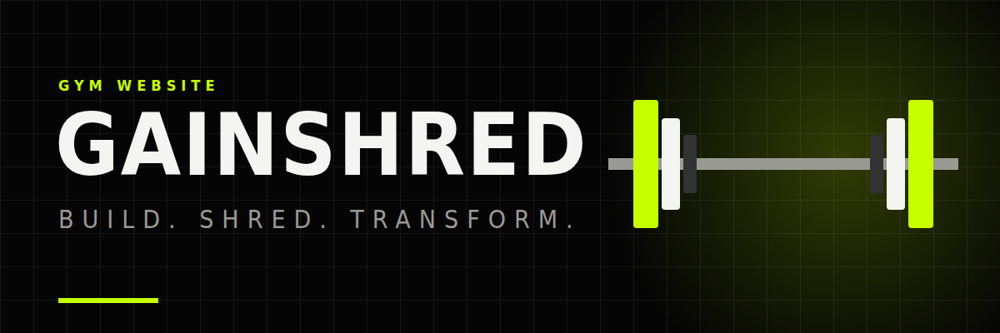
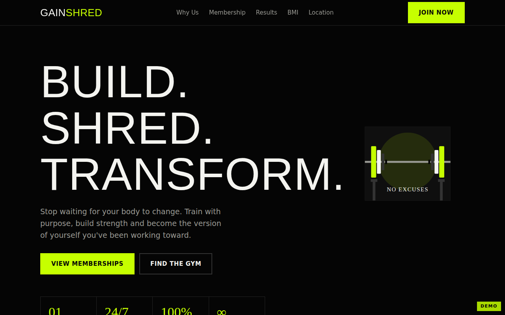
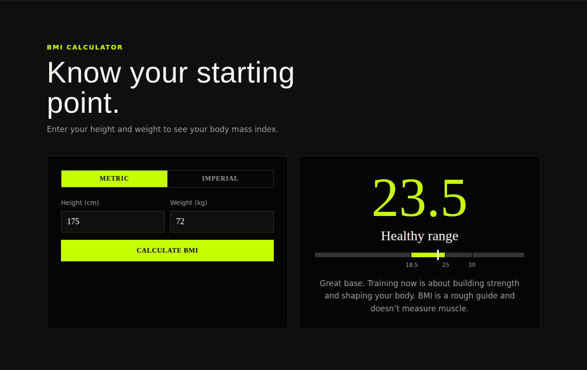

<div align="center">



# GAINSHRED GYM

**Build. Shred. Transform.**

A bold black and neon lime gym website with memberships, a BMI calculator and member transformations.

[Features](#features) · [Demo](https://jfuix.github.io/Gainshred/) · [Run locally](#run-locally) · [Credits](#credits)

</div>

---

## Features

- [x] Responsive landing page
- [x] Membership plans (Monthly, Quarterly, Annual)
- [x] Built-in BMI calculator (metric and imperial)
- [x] Before and after results section
- [x] Location and WhatsApp contact
- [ ] Online sign-up (coming soon)



## Run locally

```bash
git clone https://github.com/JFUIX/Gainshred.git
cd Gainshred
```

Open `index.html` in your browser. No build step needed.

## Credits

Designed and developed by [JAFFERY_JFUIX](https://github.com/JFUIX). Demo version.
